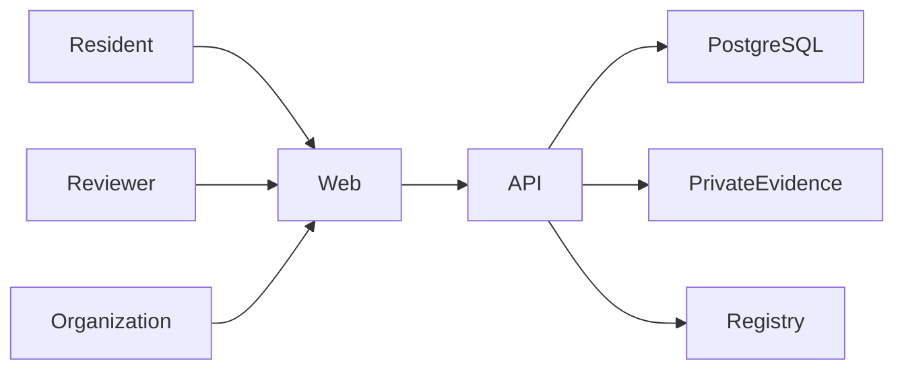

# CivicFix architecture

CivicFix separates operational case data from public audit commitments. PostgreSQL is the source of application state. Evidence files are stored privately; the API records their SHA-256 digest and deterministic manifest hash. The Solidity registry stores only opaque case identifiers and commitments, never report text, coordinates, identities, or files.

The initial local development setup uses PostgreSQL and Redis through Docker Compose. The API exposes report creation, listing, details, status history, evidence integrity, and idempotent audit-anchor endpoints. Workflow transitions are server-validated. The local evidence adapter writes files to a private application directory; it is not a production object-storage provider.

Blockchain status is separate from application status. Anchor requests create a unique PostgreSQL transaction row before submitting a write. The API uses a configured relayer, waits for an actual receipt, then reads the registry back and records `VERIFIED` only when the on-chain commitment matches. Failed writes are retained with a safe error category and can be retried by an administrator. This MVP processes submissions synchronously; it does not yet include a background queue or chain-reorganization monitor.

Blockchain proves that a commitment was recorded, not that a report or repair is truthful. Production use additionally requires managed private object storage, a durable transaction worker, monitoring, privacy review, and an independent contract audit.
